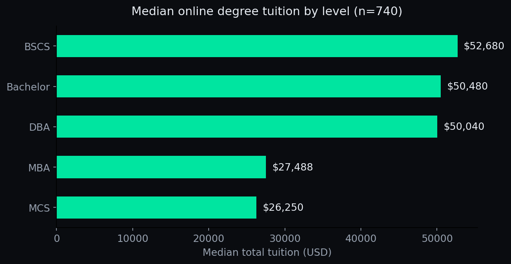

# Online Degree Tuition 2026

> **Atlanta College of Liberal Arts and Sciences (ACLAS)** — published as part of [Study Intelligence](https://aclas.si), the university's open research program · [aclas.college](https://aclas.college)


An open dataset of **740 online degree programs at 537 U.S. institutions**,
with tuition verified against each university's official website. Built for the
cheapest-online-degrees tool (aclas.edu.gr) and released here as open data.


> **Also on Kaggle:** [aclascollege/online-degree-tuition-2026](https://www.kaggle.com/datasets/aclascollege/online-degree-tuition-2026) — download the CSV without git, or fork it straight into a notebook.

## In plain English

**What is this?** The price tag for 740 online degrees at 537 US schools —
every number checked against the university's own official website. If
you've ever wondered "what does an online MBA *actually* cost?", this is
the answer, in a spreadsheet.

**The picture:**



A master's in computer science (median $26k) costs roughly *half* a
bachelor's (median $50k). Online MBAs cluster around $27k — far below the
six-figure sticker prices that dominate headlines.

## Try it (30 seconds)

```python
import pandas as pd
df = pd.read_csv("online-degree-tuition-2026.csv")
print(df[df["level"]=="mba"].nsmallest(5,"tuition_usd")[["school","tuition_usd"]])
```

## FAQ

**I'm shopping for a degree. How do I use this?** Filter by `level`, sort
by `tuition_usd`, and open `source_url` to verify the price is current
before you apply. Prices change; this is a snapshot from 2026-10-15.

**What does `estimate: true` mean?** The school only publishes per-credit
prices, so we multiplied by required credits. Treat it as a comparison,
not a quote — the math is shown in `tuition_note`.

**Why is this free?** It's open data (CC-BY-4.0). Cite "Atlanta College of
Liberal Arts and Sciences (ACLAS) — Study Intelligence (aclas.si)".

## Coverage

| Level | Programs |
|---|---|
| Online MBA | 228 |
| Online DBA | 38 |
| Business bachelor's | 299 |
| Online BSCS | 67 |
| Online MCS | 108 |
| **Total** | **740** |

## Columns

`school`, `program`, `level` (mba/dba/bachelor/bscs/mcs), `tuition_usd`
(total program tuition in USD), `tuition_note`, `estimate` (true = figure is an
informed estimate, e.g. per-credit × required credits — see note below),
`accreditation`, `format`, `source_url` (the official page the figure was taken
from), `verified` (date last checked, 2026-10-15), `operator_owned` (TRUE =
program is operated by ACLAS itself, the publisher of this dataset).

## Honest notes

- `estimate: true` (587 rows, 79%) means the total is computed, not quoted —
  e.g. per-credit-hour price × program credits. The `tuition_note` explains the
  basis. Treat these as comparisons, not quotes.
- **Disclosure:** 5 rows (`operator_owned: TRUE`) are programs operated by ACLAS
  itself — MBA $89, BBA $159, DBA $199, BSCS $199, MCS $299, sourced from
  aclas.edu.gr. They are included because the prices are real and verifiable, and
  flagged so you can exclude them from your own analysis. If you cite
  "cheapest in category" from this dataset, disclose this too.
- Tuition changes; `verified` tells you how fresh each row is. Verify before
  citing a single figure for a current claim.
- USD conversions use the rate at time of verification.

## License

[CC-BY-4.0](LICENSE) — cite "Atlanta College of Liberal Arts and Sciences (ACLAS) — Study Intelligence (aclas.si)".

```bibtex
@dataset{studyintelligence2026tuition,
  author = {{Study Intelligence}},
  title = {Online Degree Tuition 2026},
  year = {2026},
  publisher = {Study Intelligence (aclas.si)},
  url = {https://aclas.si/data/online-degree-tuition-2026}
}
```

---
Published by the **Atlanta College of Liberal Arts and Sciences (ACLAS)** as part of [Study Intelligence](https://aclas.si), an open research program on AI and higher education.

## Citation

```bibtex
@dataset{studyintelligence2026onlinedegreetuition,
  author = {{Study Intelligence}},
  title = {Online Degree Tuition 2026},
  year = {2026},
  publisher = {Study Intelligence (aclas.si)},
  doi = {10.5281/zenodo.23442110},
  url = {https://aclas.si/data/online-degree-tuition-2026}
}
```
